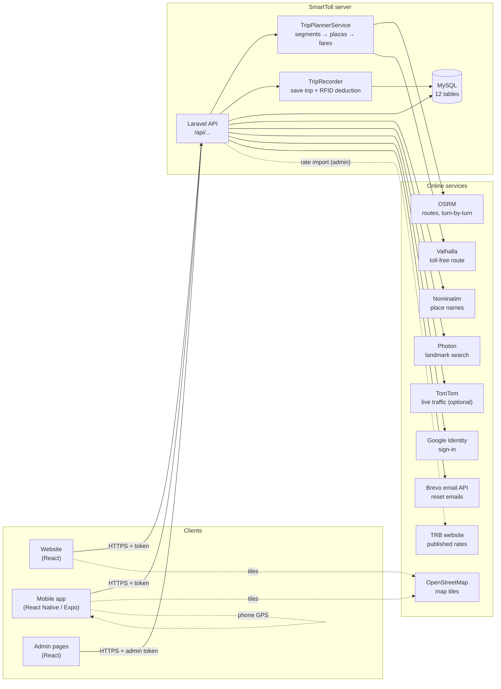
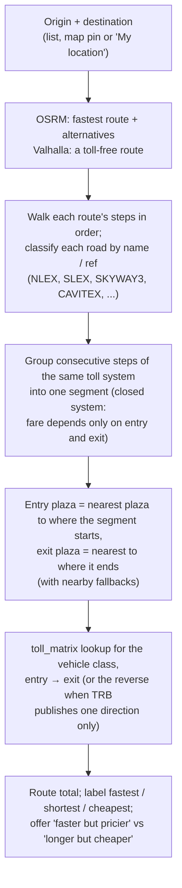
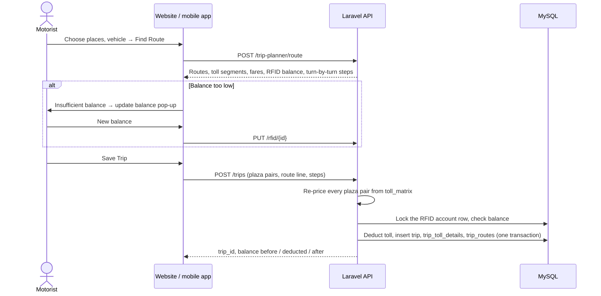
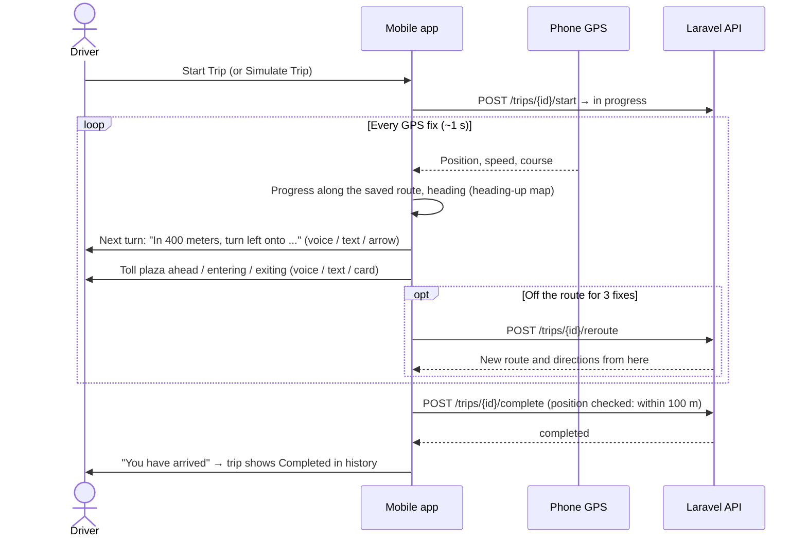
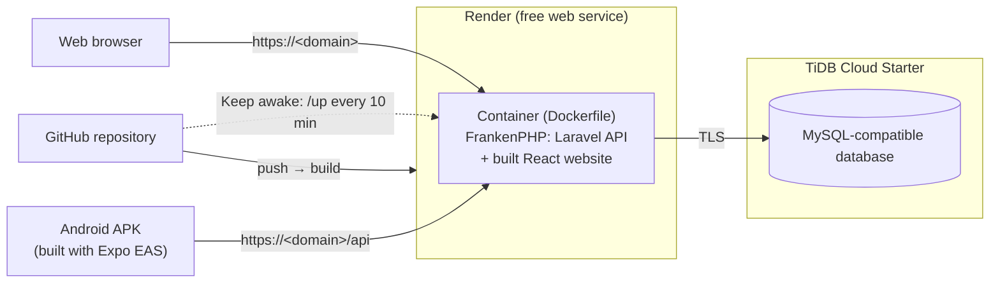

# SmartToll system architecture

SmartToll is a toll route planner with RFID balance tracking for motorists in Luzon. It has three parts that share one server:

| Part | Built with | Used by |
|---|---|---|
| **Website** | React 18, React Router, Leaflet (map), Vite | Motorists (and visitors, who can plan without an account) and administrators |
| **Mobile app** | React Native 0.86 with Expo SDK 57, Expo Router, expo-location, expo-speech, Leaflet in a WebView | Motorists on Android / iPhone |
| **API** | Laravel 12 (PHP 8.2+), Laravel Sanctum (login tokens), MySQL / MariaDB | Both apps; all toll computation happens here |

## System overview

The apps never compute fares: they send places (or plaza pairs) and the API prices them from the TRB toll matrix. When a trip is saved, the API prices it again, so a modified app can't change what is charged.

## How a toll is computed

Special cases handled: the elevated Skyway is priced as its own "SKY" plaza; Skyway Stage 3 is split from the older Skyway at Buendia; a short brush with an expressway at a single plaza is free; tolled roads without loaded rates are reported instead of priced at zero.

## Saving a trip and paying from the RFID balance

## Following a trip with GPS (mobile app)

The toll is not charged again while driving: it was deducted when the trip was saved. With "Allow all the time" location, the phone keeps following the trip when it is locked or another app is open (Android shows a notification while it does).

## Deployment

On start, the container sets up the database by itself (`php artisan smarttoll:install`: loads `smarttoll.sql` into an empty database, then runs newer migrations). Debug mode is off in production; https ends at Render's proxy, which Laravel trusts. The database connection is encrypted (TiDB Cloud accepts TLS only; `MYSQL_ATTR_SSL_CA` points at the image's CA bundle). Render's free service sleeps after 15 idle minutes, so a scheduled GitHub workflow opens `/up` every 10 minutes.

## Security measures

- **Passwords:** stored as bcrypt hashes; password-reset links are single-use and expire.
- **Logins:** Sanctum bearer tokens; administrators have a separate role checked on every admin request (`EnsureAdmin`).
- **Ownership:** every vehicle, RFID account, trip and saved route is checked against the logged-in user.
- **Server-side pricing:** fares sent by an app are ignored; trips are re-priced from the TRB matrix when saved.
- **Consistent balances:** the RFID balance is locked during a save, so two saves can't both spend the same balance.
- **Google sign-in:** the ID token is verified with Google and must be issued for SmartToll's own client ID, for a verified email.
- **Rate limits:** login-related, routing and import endpoints are throttled (see API.md).
- **Arrival check:** a trip can only be completed within 100 m of its saved destination (the app marks it on reaching the pin: within 50 m, or at the very end of the route).

## Related documents

- [DATABASE.md](DATABASE.md): entity-relationship diagram and every table and column
- [API.md](API.md): every endpoint
- [TESTING.md](TESTING.md): automated test results
