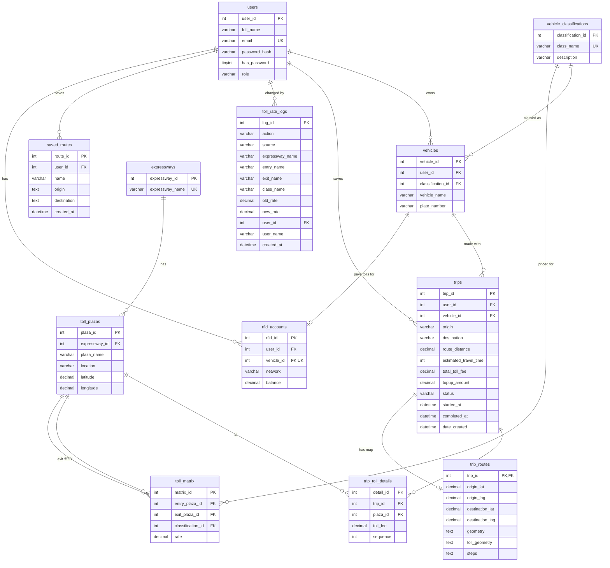

# SmartToll database

*Generated from the live MySQL schema on October 13, 2026. 12 application tables (plus 3 Laravel framework tables), 15 foreign keys.*

## Entity-relationship diagram

Read `A ||--o{ B` as "one A has zero or more B"; `||--o|` as "zero or one".

## Tables

### `users`

Motorists and administrators (role). Passwords are stored as bcrypt hashes.

| Column | Type | Null | Key |
|---|---|---|---|
| `user_id` | int(11) | no | primary key |
| `full_name` | varchar(100) | no |  |
| `email` | varchar(100) | no | unique |
| `password_hash` | varchar(255) | no |  |
| `has_password` | tinyint(1) | no | default 1; 0 for accounts made with Google until a password is set |
| `role` | varchar(20) | no |  |

### `vehicles`

A motorist's vehicles; the classification sets the toll rate.

| Column | Type | Null | Key |
|---|---|---|---|
| `vehicle_id` | int(11) | no | primary key |
| `user_id` | int(11) | no | → `users.user_id` |
| `classification_id` | int(11) | no | → `vehicle_classifications.classification_id` |
| `vehicle_name` | varchar(100) | no |  |
| `plate_number` | varchar(15) | yes |  |

### `vehicle_classifications`

TRB vehicle classes (Class 1, 2, 3) with their descriptions.

| Column | Type | Null | Key |
|---|---|---|---|
| `classification_id` | int(11) | no | primary key |
| `class_name` | varchar(20) | no | unique |
| `description` | varchar(255) | no |  |

### `rfid_accounts`

One Easytrip or Autosweep account per vehicle, with its recorded balance.

| Column | Type | Null | Key |
|---|---|---|---|
| `rfid_id` | int(11) | no | primary key |
| `user_id` | int(11) | no | → `users.user_id` |
| `vehicle_id` | int(11) | no | unique, → `vehicles.vehicle_id` |
| `network` | varchar(20) | no |  |
| `balance` | decimal(10,2) | no |  |

### `trips`

Saved trips: route summary, total toll, and progress (planned → in progress → completed).

| Column | Type | Null | Key |
|---|---|---|---|
| `trip_id` | int(11) | no | primary key |
| `user_id` | int(11) | no | → `users.user_id` |
| `vehicle_id` | int(11) | no | → `vehicles.vehicle_id` |
| `origin` | varchar(150) | no |  |
| `destination` | varchar(150) | no |  |
| `route_distance` | decimal(8,2) | no |  |
| `estimated_travel_time` | int(11) | no |  |
| `total_toll_fee` | decimal(10,2) | no |  |
| `topup_amount` | decimal(10,2) | no |  |
| `status` | varchar(20) | no |  |
| `started_at` | datetime | yes |  |
| `completed_at` | datetime | yes |  |
| `date_created` | datetime | no |  |

### `trip_toll_details`

Each trip's toll plazas in order: the entry plaza at ₱0, then the exit plaza with the fare.

| Column | Type | Null | Key |
|---|---|---|---|
| `detail_id` | int(11) | no | primary key |
| `trip_id` | int(11) | no | → `trips.trip_id` |
| `plaza_id` | int(11) | no | → `toll_plazas.plaza_id` |
| `toll_fee` | decimal(10,2) | no |  |
| `sequence` | int(11) | no |  |

### `trip_routes`

Each trip's map: origin/destination coordinates, route line, toll stretches and turn-by-turn steps.

| Column | Type | Null | Key |
|---|---|---|---|
| `trip_id` | int(11) | no | primary key, → `trips.trip_id` |
| `origin_lat` | decimal(10,7) | no |  |
| `origin_lng` | decimal(10,7) | no |  |
| `destination_lat` | decimal(10,7) | no |  |
| `destination_lng` | decimal(10,7) | no |  |
| `geometry` | longtext | no |  |
| `toll_geometry` | longtext | no |  |
| `steps` | longtext | yes |  |

### `saved_routes`

A motorist's saved routes ("Home → Office").

| Column | Type | Null | Key |
|---|---|---|---|
| `route_id` | int(10) unsigned | no | primary key |
| `user_id` | int(11) | no | → `users.user_id` |
| `name` | varchar(100) | no |  |
| `origin` | text | no |  |
| `destination` | text | no |  |
| `created_at` | datetime | no |  |

### `expressways`

Toll expressways (NLEX / SCTEX, SLEX, TPLEX, CAVITEX, ...).

| Column | Type | Null | Key |
|---|---|---|---|
| `expressway_id` | int(11) | no | primary key |
| `expressway_name` | varchar(100) | no | unique |

### `toll_plazas`

Toll plazas of each expressway, with map coordinates.

| Column | Type | Null | Key |
|---|---|---|---|
| `plaza_id` | int(11) | no | primary key |
| `expressway_id` | int(11) | no | → `expressways.expressway_id` |
| `plaza_name` | varchar(100) | no |  |
| `location` | varchar(150) | no |  |
| `latitude` | decimal(10,7) | no |  |
| `longitude` | decimal(10,7) | no |  |

### `toll_matrix`

Published TRB fare for each entry plaza → exit plaza pair and vehicle class.

| Column | Type | Null | Key |
|---|---|---|---|
| `matrix_id` | int(11) | no | primary key |
| `entry_plaza_id` | int(11) | no | → `toll_plazas.plaza_id` |
| `exit_plaza_id` | int(11) | no | → `toll_plazas.plaza_id` |
| `classification_id` | int(11) | no | → `vehicle_classifications.classification_id` |
| `rate` | decimal(10,2) | no |  |

### `toll_rate_logs`

Change log of toll rates: old → new, who, when and the source (edit, CSV, TRB import).

| Column | Type | Null | Key |
|---|---|---|---|
| `log_id` | int(10) unsigned | no | primary key |
| `action` | varchar(10) | no |  |
| `source` | varchar(20) | no |  |
| `expressway_name` | varchar(100) | no |  |
| `entry_name` | varchar(100) | no |  |
| `exit_name` | varchar(100) | no |  |
| `class_name` | varchar(20) | no |  |
| `old_rate` | decimal(10,2) | yes |  |
| `new_rate` | decimal(10,2) | yes |  |
| `user_id` | int(11) | yes | → `users.user_id` |
| `user_name` | varchar(100) | yes |  |
| `created_at` | datetime | no |  |

### `migrations`

Laravel: which database migrations have run.

| Column | Type | Null | Key |
|---|---|---|---|
| `id` | int(10) unsigned | no | primary key |
| `migration` | varchar(255) | no |  |
| `batch` | int(11) | no |  |

### `password_reset_tokens`

Laravel: one-time tokens for password-reset emails.

| Column | Type | Null | Key |
|---|---|---|---|
| `email` | varchar(255) | no | primary key |
| `token` | varchar(255) | no |  |
| `created_at` | timestamp | yes |  |

### `personal_access_tokens`

Laravel Sanctum: login tokens of the website and the mobile app.

| Column | Type | Null | Key |
|---|---|---|---|
| `id` | bigint(20) unsigned | no | primary key |
| `tokenable_type` | varchar(255) | no |  |
| `tokenable_id` | bigint(20) unsigned | no |  |
| `name` | varchar(255) | no |  |
| `token` | varchar(64) | no | unique |
| `abilities` | text | yes |  |
| `last_used_at` | timestamp | yes |  |
| `expires_at` | timestamp | yes |  |
| `created_at` | timestamp | yes |  |
| `updated_at` | timestamp | yes |  |
